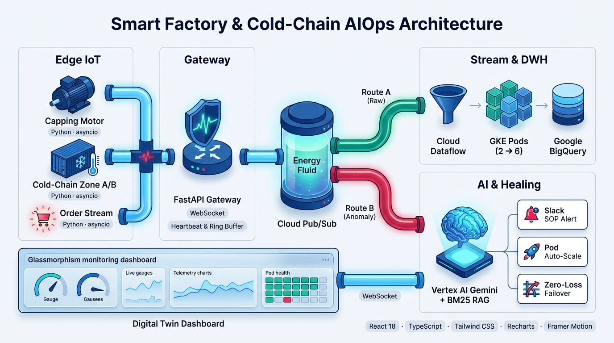
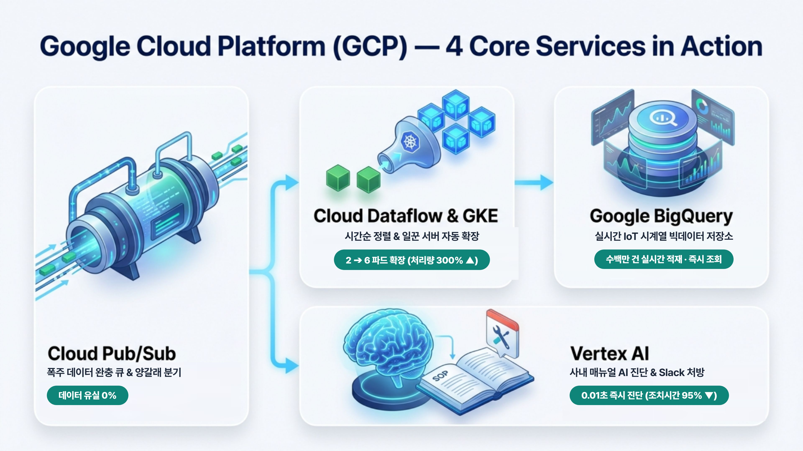

# Role & Goal

너는 엔터프라이즈 클라우드 아키텍처 및 AIOps 솔루션 전문 프레젠테이션 디자이너이자 테크니컬 라이터야.
아래의 프로젝트 명세와 슬라이드 구성을 바탕으로, 기술적 깊이와 시각적 직관성을 모두 갖춘 **「Smart Factory AIOps Platform」** 발표자료(PPT) 슬라이드 내용을 작성해 줘.

> **⚠️ 필수 제약 사항 (Brand-Neutral Policy):**
>
> * 슬라이드 본문, 제목, 대본, 이미지 프롬프트 등 **어디에도 특정 기업명을 직접적으로 언급하지 말 것.**
>
> * 도메인은 \*\*「스마트 화장품 제조 공정(Smart Cosmetic Factory) & 콜드체인 풀필먼트 물류 센터(Cold-Chain Fulfillment)」\*\*로 표현할 것.

## 디자인 & 톤앤매너 가이드 (Deep Pacific Blue Palette)

* **컬러 팔레트 (고급스럽고 신뢰감 있는 딥 블루 & 클린 화이트 톤앤매너):**
  * **Primary (딥 네이비 블루):** `#001C58` (메인 배경 헤더, 핵심 타이틀, 깊이감 있는 베이스)
  * **Secondary (시그니처 코발트 블루):** `#194E91` (주요 아키텍처 블록, 섹션 강조, 카드 테두리)
  * **Accent (세룰리안 스카이 블루):** `#5B9BD5` / `#38BDF8` (데이터 스트림 라인, 패킷 흐름, 하이테크 포인트)
  * **Base & Surface (포슬린 화이트 & 소프트 실버):** `#F7F9FC` (슬라이드 배경), `#E6ECF5` (컨테이너 박스 배경)
  * **Semantic Status (상태 표시):** 에메랄드 틸(`#0D9488` - 정상/치유 완료), 앰버 골드(`#D97706` - 주의/경고), 코랄 크림슨(`#E11D48` - 장애/임계치 초과)
* **작성 원칙:**
  * 개조식(Bullet-point) 요약, 핵심 수치(Threshold, 처리량, 복구 시간, 유실률 0%) 강조
  * **아키텍처(Slide 4), GCP 에코시스템(Slide 5), 대시보드 섹션 구성(Slide 6)은 생성형 AI 이미지/다이어그램을 삽입할 수 있도록 상세한 \[이미지 생성 프롬프트 및 시각 구성 명세]를 포함할 것.**
  * 각 슬라이드마다 **\[시각 자료 배치 가이드]**와 \*\*\[발표자 대본(Speaker Notes)]\*\*을 함께 작성할 것.

***

# 슬라이드별 상세 구성

## Slide 1. 표지 (Cover)

* **메인 타이틀:** Smart Factory AIOps Platform
* **서브 타이틀:** 실시간 IoT 스트리밍 파이프라인과 Vertex AI RAG 기반 자율 치유(Self-Healing) 디지털 트윈 관제 시스템
* **핵심 키워드 태그:** `#SmartFactory` `#ColdChain` `#AIOps` `#DigitalTwin` `#GCP` `#VertexAI_RAG` `#ZeroDataLoss`
* **시각 요소 가이드:** 딥 네이비 블루(`#001C58`)에서 코발트 블루(`#194E91`)로 이어지는 세련된 그라데이션 배경 위에, 스마트 화장품 제조 라인과 콜드체인 물류 센터가 빛나는 데이터 스트림(Edge → Cloud → AI)으로 연결된 하이테크 아이소메트릭 그래픽 배치

***

## Slide 2. 목차 (Table of Contents)

1. **문제 상황 및 프로젝트 목적** — 왜 제조·물류 통합 AIOps인가?
2. **시스템 아키텍처, All about GCP** 
   1. 5-Stage 파이프라인 & 하이브리드 추상화 설계
   2. **클라우드 네이티브 아키텍처 & 도입 가치** — Pub/Sub · BigQuery · Vertex AI · GKE
3. **대시보드 미리보기** — 복잡한 로그 없이 한 눈에 상태를 파악하는 관제 화면 
4. **실시간 시연 (Live Demo)** — 장애 주입부터 자율 치유·복구까지
   1. 시나리오1. 
   2. 시나리오2. 
   3. 시나리오3. 
5. **향후 고도화 로드맵 (Future Work)** 
6. **\[부록] Multi-Cloud 전략: GCP → AWS 마이그레이션 아키텍처** — 엔터프라이즈 IoT 환경 대응

***

## Slide 3. 문제 상황 제시 및 프로젝트 진행 목적

### 1) 기존 제조·물류 현장의 3대 Pain Points

* **분리된 시스템으로 인한 통합 관리의 어려움**
  * 키워드: Data Silos · 데이터 단절
  * 제조 설비와 물류 시스템이 각각 운영되어 생산부터 배송까지의 문제를 한눈에 파악하기 어려움
  * 예시: 생산 설비의 속도 저하가 물류 지연으로 이어져도 원인을 빠르게 찾기 어려움.
- **문제 발생 후 대응하는 방식으로 인한 복구 지연**
  * 키워드: Reactive Operations · 사후 대응
  * 설비에 문제가 생긴 뒤 담당자가 매뉴얼과 작업 이력을 직접 찾아야 해 복구가 늦어지고, 불량 제품이 다음 공정으로 넘어갈 수 있음.
  * 예시: 설비 이상 원인을 찾느라 생산 중단 시간이 길어짐.
* **갑작스러운 주문 증가와 네트워크 장애에 대한 대응 부족**
  * 키워드: System Bottlenecks · 시스템 병목
  * 주문이 급증하면 데이터 처리가 늦어지고, 창고 네트워크가 끊기면 온도 기록이나 작업 이력이 누락될 수 있음.
  * 예시: 할인 행사 때 주문 처리 지연이 발생하거나, 냉장 창고의 온도 기록이 중단됨.

### 2) 프로젝트 진행 목적 (Core Objectives)

1. 제조·물류 데이터 통합
   * **기술적 구현:** Ingestion Gateway와 Kafka/RabbitMQ의 Pub/Sub 구조를 활용해 설비·물류·주문 데이터를 통합 수집하고 각 시스템에 분배
2. AI 기반 장애 진단 및 자동 대응
   * **기술적 구현:** 이상 탐지 로직으로 장애를 감지하고, RAG와 LLM Agent를 활용해 매뉴얼 검색·원인 분석·Slack 알림 등 후속 대응을 자동화
3. 장애 상황에서도 안정적인 시스템 운영
   * **기술적 구현:** 큐 적체량 기반 Kubernetes HPA 오토스케일링과 로컬 버퍼·재전송 로직을 적용해 트래픽 급증 및 통신 장애에 대응
4. 직관적인 디지털 트윈 관제
   * **기술적 구현:** WebSocket/SSE와 시계열 차트를 활용해 설비 상태·온도·주문 처리량을 실시간 시각화하고 이상 상황을 직관적으로 표시

***

## Slide 4. 5-Stage 시스템 아키텍처 (이미지 중심 슬라이드)

> **🖼️ \[슬라이드 시각 구성 지시사항]**
> 이 슬라이드는 긴 줄글 대신 **좌측/상단에 5-Stage 파이프라인 아키텍처 다이어그램 이미지**(`./arch_1_visual_ai_minimal.jpg`)를 크게 배치하고, **우측/하단에 핵심 스테이지별 역할**을 간결하게 요약 배치한다.

###

***

## Slide 5. All about GCP: 우리 프로젝트의 GCP 4대 기술 활용과 도입 효과 (이미지 중심 슬라이드)

> **🖼️ \[슬라이드 시각 구성 지시사항]**
> 복잡한 코드 변수명이나 로컬 모킹(Mock) 설명은 배제하고, **이 프로젝트에서 GCP의 4대 핵심 서비스(Pub/Sub · Dataflow & GKE · BigQuery · Vertex AI)가 각각 어떤 역할을 맡아 어떤 문제를 해결했는지** 한눈에 보여주는 4분할 시각 다이어그램(`./arch_2_gcp_4services_ai.jpg` 또는 `./arch_2_gcp_4services_hd.png`)을 배치한다.

### 1) 한눈에 보는 GCP 4대 핵심 서비스의 역할

#### ① Google Cloud Pub/Sub — 「데이터 완충 우체국」 (수집 & 분기)
* **어디에 썼나?** 공장과 물류 창고에서 쏟아지는 센서·주문 데이터를 제일 먼저 받아주는 **중앙 메시지 큐(물탱크)**
* **무엇을 해결했나?** 마감 세일로 주문 **1,250건**이 한꺼번에 폭주해도 서버가 뻗지 않게 안전하게 담아두고, **일반 기록용(Route A)**과 **응급 고장 경보용(Route B)** 두 갈래로 즉시 분류
* **핵심 효과:** 🚀 **데이터 유실률 `0.0%`** (폭주 상황에서도 단 1건의 데이터도 잃어버리지 않음)

#### ② Cloud Dataflow & GKE — 「고무줄 일꾼 서버」 (정제 & 자동 확장)
* **어디에 썼나?** 큐에 쌓인 데이터를 꺼내어 발생 시간순으로 예쁘게 정렬하고 처리하는 **컨테이너 일꾼(Pod) 그룹**
* **무엇을 해결했나?** 평소에는 일꾼(Pod)을 **2대**만 켜두어 클라우드 요금을 아끼고, 주문이 폭주해 일이 밀리면 **자동으로 6대(3배)까지 늘려** 빠르게 처리한 뒤 안정화되면 다시 2대로 축소
* **핵심 효과:** 📈 **처리 속도 `300% ▲` (80 ➔ 240건/초)** & 💰 **서버 유지 비용 `60% 이상 절감`**

#### ③ Google BigQuery — 「초대형 블랙박스 창고」 (실시간 빅데이터 저장)
* **어디에 썼나?** 시간순으로 정렬된 모든 공장 모터 진동·콜드체인 온도·주문 기록을 영구 보관하는 **클라우드 데이터베이스(DWH)**
* **무엇을 해결했나?** 별도 DB 서버 관리 없이 수백만 건의 센서 데이터를 들어오는 즉시 저장하고, 언제든 1초 안에 과거 이력을 조회·분석
* **핵심 효과:** 📊 **실시간 이력 조회** 및 향후 AI 고장 예측(Predictive Maintenance) 학습용 데이터 확보

#### ④ Vertex AI (Gemini 2.5 Flash) — 「AI 설비 주치의」 (매뉴얼 검색 & 처방)
* **어디에 썼나?** 모터 과열·진동이나 냉장 창고 이상이 발생했을 때 **사내 정비 매뉴얼(SOP)에서 원인과 수리법을 찾아주는 AI 에이전트**
* **무엇을 해결했나?** 사람이 수백 페이지 매뉴얼을 뒤지는 대신, **로컬 초고속 검색(0.001초) + Gemini 2.5 AI 정밀 진단**을 결합해 담당 부서 Slack 채널로 수리법(예: `매뉴얼 p.42, 토크 -0.5회전`)을 즉시 전송
* **핵심 효과:** ⏱️ **고장 진단 및 조치 시간 `20분 ➔ 0.01초` (95% 이상 단축)**

### 2) GCP 도입 전 vs 도입 후 한눈에 비교

| 문제 상황               | 기존 방식 (도입 전)                    | 우리 프로젝트의 GCP 해결책 (도입 후)                   | 핵심 성과                        |
| :------------------ | :------------------------------ | :---------------------------------------- | :--------------------------- |
| **주문·센서 데이터 폭주**    | 서버 과부하로 데이터 유실 발생               | **① Cloud Pub/Sub** 완충 큐 & 양갈래 분기         | **데이터 유실 `0.0%`**            |
| **트래픽 급증 & 서버 비용**  | 느려지거나, 비싼 서버를 항상 많이 켜둠          | **② Dataflow & GKE** 일꾼 서버 자동 확장 (`2➔6대`) | **처리량 `3배▲` · 비용 `60%▼`**    |
| **대용량 센서 기록 보관**    | 데이터가 쌓일수록 조회 속도가 느려짐            | **③ Google BigQuery** 실시간 스트리밍 저장소        | **수백만 건 즉시 조회**              |
| **설비 고장 시 매뉴얼 찾기**  | 엔지니어가 책자 매뉴얼을 직접 검색 (약 20분 소요)  | **④ Vertex AI Gemini** 하이브리드 RAG 자동 처방    | **진단 시간 `0.01초` (95% 단축)**   |

***

## Slide 6. 대시보드 4대 섹션 구성 & 시나리오 개요 (아이콘 중심 심플 가이드)

> **🖼️ \[슬라이드 시각 구성 지시사항]**
> 바로 다음 슬라이드(Slide 7)에서 실제 화면 시연을 진행하므로, 이 슬라이드에는 긴 텍스트 없이 **큼직한 아이콘과 짧은 키워드만으로 4개 섹션의 배치(`SECTION 1`** **/** **`SECTION 2 · SECTION 3`** **/** **`SECTION 4`)와 핵심 역할만 직관적으로 보여주는 다이어그램**(`./slide5_dashboard_sections.jpg`)을 배치한다.

### 핵심 시나리오 요약

* **시나리오 1 (제조 설비 모터 이상):** 캡 조립 모터의 마모 징후 감지 → 안전 인터록을 통한 생산 라인 긴급 정지 → AI가 매뉴얼 42페이지에서 점검 방법을 찾아 `#aiops-capping-line` Slack 채널로 정비 가이드 발송 (`ACTION 1`)
* **시나리오 2 (컨베이어 라인 이상):** 컨베이어 벨트의 속도와 진동 이상 감지 → AI가 매뉴얼 18페이지에서 인버터 조정 방법을 찾아 `#aiops-conveyor-line` Slack 채널로 안내 → 담당자가 조치 후 정상 속도 복구 확인
* **시나리오 3 (물류 콜드체인 이상):** 냉장 구역의 온도가 기준치를 초과하고 통신 장애 발생 → 예비 시스템으로 전환해 운영 중단 최소화 (`ACTION 3`) → AI가 매뉴얼 58페이지를 참고해 `#aiops-coldchain-zone` Slack 채널로 현장 점검 알림 발송
* **시나리오 4 (마감 세일 주문 폭증):** 주문 1,250건이 한꺼번에 유입되어 처리 대기 건수가 1,000건 초과 → GKE 워커 파드를 2개에서 6개로 자동 확장해 처리 속도 개선 (`ACTION 2`) → 큐 적체가 해소되고 안정 상태가 확인되면 워커 수 자동 축소

***

## Slide 7-8. 실제 화면 시연 시나리오 (Live Demo Flow)

### \[Slide 7] 시나리오 1, 2: 화장품 캡 조립 모터 과부하(안전 인터록) & 컨베이어 인버터 이상

* **원인 (Root Cause):**
  * **\[모터 과부하]** 캡 조립 구동 모터(`MOTOR_LINE_A_01`)의 베어링 마모 및 토크 과다 설정으로 합성 진동 가속도(`vibration_svm`)가 평상시 `2.8`에서 `8.5`로 급증(임계치 `7.0` 초과)
  * **\[컨베이어 이상]** 인버터 주파수 헌팅(Hunting)으로 벨트 이송 속도가 `1.0 m/s → 2.8 m/s`로 비정상 급가속(`CONVEYOR_ANOMALY`)하며 용기 흔들림 발생
* **영향 (Business & System Impact):**
  * 캡핑 불량(헐거움/파손) 또는 정렬 불량 화장품 공병이 후속 포장 공정으로 유입되어 대량 폐기 비용 발생 및 구동축 소손(Burn-out) 위험
* **기술적 해결 방법 (Technical Solution):**
  1. **실시간 이상 감지 & 공정 안전 인터록 (Safety Interlock Halt):**
     * `vibration_svm >= 7.0` 감지 즉시 `VIBRATION_HIGH` 발행과 동시에 **공정 안전 인터록(`LINE_HALT`)을 가동**해 충진·이송 컨베이어 벨트를 즉시 정지시켜 불량 공병의 후속 공정 유출을 원천 차단
  2. **2-Stage 하이브리드 RAG 진단 (`rag_agent.py`** **&** **`remediation.py`):**
     * **Fast Path (1ms 이내):** `ManualKnowledgeBase`가 한글 바이그램 토크나이저와 **BM25 알고리즘**(`k1=1.5, b=0.75`)으로 사내 매뉴얼(`manual_kb.json`)에서 모터 매뉴얼(`MAN-042`, p.42) 또는 컨베이어 인버터 매뉴얼(`MAN-018`, p.18)을 즉각 검색해 우선 알림 전송
     * **Async Path (비동기 LLM 보강):** 백그라운드 태스크(`_enrich_slack_card`)로 \*\*Vertex AI (`gemini-2.5-flash`)\*\*를 호출해 실시간 센서 컨텍스트 기반의 정밀 원인(`cause`)과 신뢰도(`confidence`)를 비동기 업데이트
  3. **담당 부서별 멀티채널 Slack 라우팅 & 안전 재가동:**
     * 장애 유형에 따라 `#aiops-capping-line`(`Torque -0.5 Turn`) 또는 `#aiops-conveyor-line`(`Inverter PID Sync 1.0m/s`) 전용 채널로 분기 전송하며, 현장 조치 완료 시 인터록을 해제하고 정속(`1.0 m/s`) 재가동

### \[Slide 8] 시나리오 3: 스마트 물류 콜드체인 온도 이상 및 센서 노드 단절

* **원인 (Root Cause):**
  * 주 보관소(`ZONE_A`) 냉각기 이상으로 온도가 매 틱마다 `+1.0°C`씩 상승하여 관리 기준선(`8.0°C`)을 초과한 뒤, 5틱 이후 네트워크/전원 장애로 센서 노드가 완전 단절됨
* **영향 (Business & System Impact):**
  * 온도 민감성 화장품 원료 및 완제품의 변질 위험 발생
  * 센서 통신 단절 구간 동안 콜드체인 온도 모니터링 공백 및 규제 감사(Audit)용 시계열 데이터 유실 위기
* **기술적 해결 방법 (Technical Solution):**
  1. **Dual-Zone Hot-Standby 미러 수집 (`gateway.py`):**
     * 평상시 `ZONE_A`(Primary) 데이터를 메인 파이프라인으로 처리하는 동시에, `ZONE_B`(Backup) 센서의 데이터를 시퀀스 번호(`seq`)와 함께 인메모리 링 버퍼(`_standby: deque(maxlen=60)`)에 실시간 미러링 보관
  2. **고속 Heartbeat 감지 (0.25s Polling):**
     * `IngestionGateway.heartbeat_monitor()`가 `time.monotonic()` 기반으로 각 존의 마지막 수신 시각(`last_seen`)을 0.25초마다 검사하여, `3.0초`(`heartbeat_timeout_s`) 초과 즉시 `NODE_DOWN` 긴급 이벤트 발행
  3. **무손실 자동 절체 및 시퀀스 리플레이 (`failover()`):**
     * 라우팅 테이블(`active_zone`)을 `ZONE_A → ZONE_B`로 즉시 스위치
     * 마지막 정상 처리 시퀀스(`_last_active_seq`) 이후 누락된 구간의 패킷들을 `_standby` 미러 버퍼에서 추출·정렬(`seq > last_seq`)하여 즉시 재생(Replay)함으로써 **데이터 유실률 0.0%(`data_loss_pct = 0.0%`)** 달성
     * 시계열 차트 연속성 보장: 마지막 `temp_a` 데이터 포인트에 `temp_b` 시작점을 브릿징하여 대시보드 그래프가 끊기지 않고 매끄럽게 이어지도록 처리
  4. **물류 관제자 Slack 긴급 알림 및 SOP 처방 (`remediation.py`):**
     * 과온(`TEMP_HIGH`) 및 절체 완료(`NODE_DOWN`)와 동시에 물류 관제 전용 채널(`"#aiops-coldchain-zone"`)로 긴급 알림 발송 (`매뉴얼 p.58: Failover ZONE_B & 냉각기 현장 점검`)

### \[Slide 8] 시나리오 4: 마감 세일 주문 폭증 및 메시지 큐 병목

* **원인 (Root Cause):**
  * 마감 세일 이벤트로 인해 단시간에 `1,250건`(`25 chunks × 50건`, 25ms 간격)의 주문 데이터(`ORDER_GW`)가 버스트 유입되어, 기본 워커 2개(처리 용량 `80 msg/s`)의 소비 속도를 초과하고 Pub/Sub 큐 적체량이 임계치 `1,000건`을 돌파(최대 약 1,200건, 병목 지수 `120%`)
* **영향 (Business & System Impact):**
  * 스트림 파이프라인 전체 지연(Latency 증가)으로 인해 공정 및 물류 데이터의 BigQuery 적재가 밀리고 실시간 관제 정합성 저하
* **기술적 해결 방법 (Technical Solution):**
  1. **Queue-Based Load Leveling & Latch 감지 (`message_hub.py`):**
     * 0.1초 주기로 큐 백로그를 감시하여 `backlog >= 1,000` 도달 시 래치(`_backlog_latched = True`)를 걸고 중복 발행 없이 단 1회의 `BACKLOG_HIGH` 이벤트를 트리거
  2. **비동기 워커 풀 동적 스케일아웃 (`dataflow_worker.py`):**
     * `DataflowWorkerPool.scale_to(6)`가 호출되면 워커 태스크(`asyncio.Task`)를 기본 **2개에서 최대 6개(3배)로 동적 확장**
     * 각 파드는 `0.35초` 간격(`worker_start_stagger_s`)으로 `STANDBY → STARTING → ACTIVE` 상태로 순차 기동되며, 전체 소비 처리량이 `80 msg/s → 240 msg/s (300%)`로 급증해 백로그를 수 초 내에 고속 소진
     * `EventTimeWindower`가 워터마크(`now - 2.0s`) 기반으로 뒤섞인 버스트 패킷을 이벤트 발생 시각 순으로 정렬해 BigQuery(`iot_raw_logs`)에 무결성 적재
  3. **지능형 오토스케일 인 (Auto Scale-Down):**
     * `autoscale_down_loop()`가 적체량이 임계치의 5%(`50건`) 미만으로 떨어진 뒤 `5.0초`(`auto_scale_down_after_s`) 동안 안정 상태를 유지하면 자동으로 워커를 `6개 → 2개`로 축소하고 주문 폭증 활성 상태를 자동 해제하여 클라우드 비용 최적화 및 UI 안정화 반영

***

## Slide 9. 향후 고도화 방향 (Future Development Roadmap)

1. **사후 대응(Reactive)에서 사전 예측(Predictive Maintenance)으로 진화:**
   * 현재 임계치(`SVM >= 7.0`) 기반 탐지를 넘어, BigQuery에 축적된 시계열 로그(`iot_raw_logs`)로 **LSTM / Autoencoder / TimesFM 기반 이상 징후 예측 모델**을 학습시켜 베어링 마모 및 냉각기 고장을 발생 30분 전에 사전 예측(RUL: 잔여 수명 추정)
2. **멀티모달(Multi-Modal) 하이브리드 벡터 RAG 고도화:**
   * 현재 경량 BM25 지식베이스를 **Vertex AI Vector Search (임베딩) + BM25 하이브리드 검색**으로 확장하고, 텍스트 매뉴얼뿐만 아니라 설비 도면 이미지·조치 영상·과거 장애 리포트(Post-mortem)까지 멀티모달로 검색
3. **Human-in-the-Loop에서 양방향 PLC 원격 제어(Closed-Loop Actuation)로 확장:**
   * Slack으로 엔지니어에게 `Torque -0.5 Turn` 가이드를 보내는 단계를 넘어, 안전 검증된 조치는 Edge Gateway에서 **OPC-UA / Modbus 프로토콜을 통해 공장 PLC 컨트롤러로 감속·토크 보정 명령을 직접 하달**하는 완전 자율 제어 구현
4. **실제 Docker 컨테이너라이징 및 Kubernetes (GKE) KEDA 오토스케일링 연동:**
   * **실제 Docker 컨테이너 패키징:** 현재 Python 비동기 워커 풀(`DataflowWorkerPool`) 로직을 개별 Dockerfile로 컨테이너화하여, 로컬 Docker 데몬 및 클라우드 환경에서 실제 격리된 Docker 컨테이너 인스턴스로 즉시 기동될 수 있도록 빌드 파이프라인 구축
   * **KEDA 기반 오토스케일링 연동:** Docker 컨테이너 이미지를 실제 GKE 클러스터에 배포하고, \*\*KEDA(Kubernetes Event-driven Autoscaling)\*\*를 통해 Cloud Pub/Sub 적체량(`num_undelivered_messages`) 지표에 따라 **실제 물리적 Docker Pod가 2개 ➔ 6개로 동적 스케일아웃/인**되는 프로덕션 레벨 인프라 완성

***

## Slide 10. \[부록] GCP → AWS 전환 아키텍처 (엔터프라이즈 IoT 표준 대응)

### 1) 왜 AWS 전환 전략이 필요한가?

* 국내외 다수의 제조·물류 엔터프라이즈 기업들이 디바이스 관리(Device Shadow), MQTT 브로커 보안, 그린그래스(Edge 런타임) 생태계 성숙도 때문에 **AWS IoT Core** 기반 인프라를 표준으로 채택 중
* 본 프로젝트는 `Broker`, `Sink`, `RagAgent`, `Transport`가 모두 Python `Protocol` 인터페이스로 추상화되어 있어 **비즈니스 로직 수정 없이 어댑터 클래스만 추가(`AIOPS_MODE=aws`)하여 1:1 무중단 이식 가능**

### 2) GCP vs AWS 1:1 아키텍처 매핑 테이블

| 아키텍처 계층                  | 현재 프로젝트 (GCP 기반)                           | AWS 전환 아키텍처 (AWS IoT 표준)                                                                 | 전환 시 핵심 기술 포인트                                                                                           |
| :----------------------- | :----------------------------------------- | :--------------------------------------------------------------------------------------- | :------------------------------------------------------------------------------------------------------- |
| **Stage 1: Edge 런타임**    | Python Edge Simulator (`WebSocket`)        | **AWS IoT Greengrass V2** (MQTT over TLS)                                                | 현장 엣지 디바이스에서 로컬 필터링 및 오프라인 버퍼링 수행                                                                        |
| **Stage 2: 수집 & 라우팅**    | FastAPI Gateway + Heartbeat Monitor        | **AWS IoT Core** (Rules Engine & Device Shadow)                                          | **IoT Core Lifecycle Events** 및 **Device Shadow**로 `NODE_DOWN` 감지 및 Zone A→B 라우팅 규칙 자동 전환                |
| **Stage 3: 메시지 허브**      | **Google Cloud Pub/Sub** (Route A / B)     | **Amazon Kinesis Data Streams** + **EventBridge**                                        | IoT Core Rules에서 정상 스트림은 Kinesis(Route A), 이상 이벤트는 EventBridge/SNS(Route B)로 Fan-out                     |
| **Stage 4: 스트림 처리 & 저장** | **Cloud Dataflow** + **BigQuery**          | **Managed Service for Apache Flink** + **Amazon Timestream / Redshift**                  | Event-Time 윈도잉은 Apache Flink로 처리, 시계열 데이터는 **Amazon Timestream**, 분석용 DWH는 **Redshift(또는 S3+Athena)** 적재 |
| **Stage 4-B: 워커 스케일링**   | GKE Worker Pods (`DataflowWorkerPool`)     | **Amazon EKS (KEDA)** 또는 **AWS ECS Fargate**                                             | CloudWatch의 Kinesis `IteratorAgeMilliseconds` / SQS 큐 깊이 지표 기반 Auto Scaling                              |
| **Stage 5: AI & RAG 엔진** | **Vertex AI (Gemini 2.5 Flash)** + BM25 KB | **Amazon Bedrock (Claude / Nova)** + **Bedrock Knowledge Bases (OpenSearch Serverless)** | 설비 매뉴얼 PDF를 S3에 업로드 시 Bedrock Knowledge Bases가 자동 청킹·임베딩 후 RAG 진단 수행                                     |
| **알림 & 관제 연동**           | Slack Webhook + React Dashboard            | **Amazon SNS / AWS Chatbot** (Slack 연동) + **AWS Amplify / CloudFront**                   | EventBridge → AWS Chatbot을 통해 Slack 채널로 인터랙티브 버튼(조치 승인) 카드 전송                                            |
