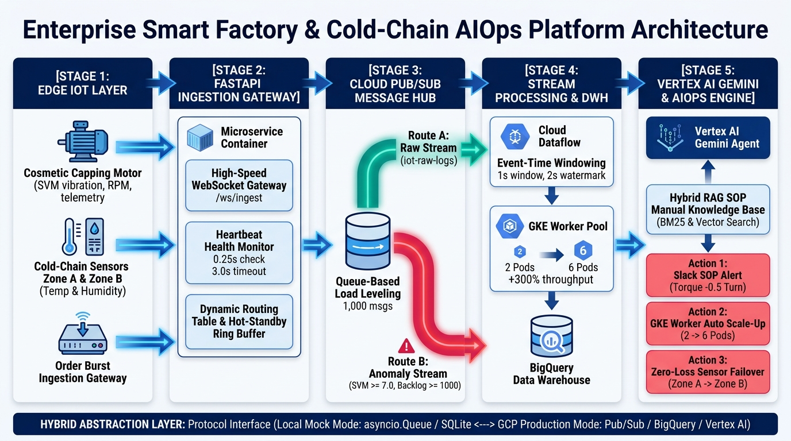
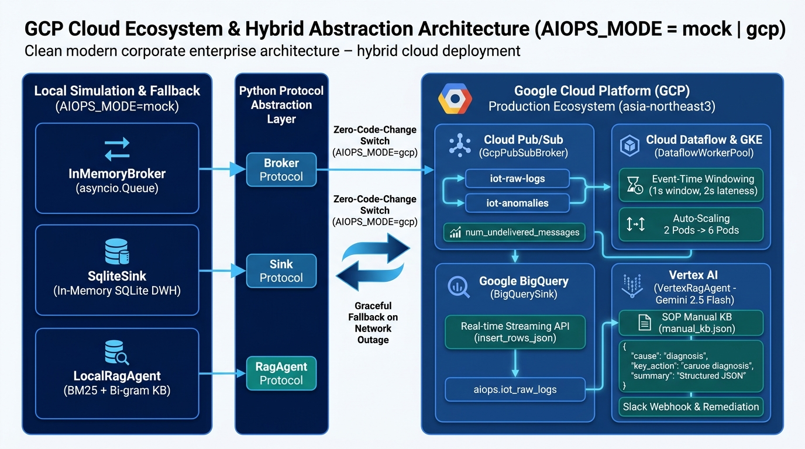
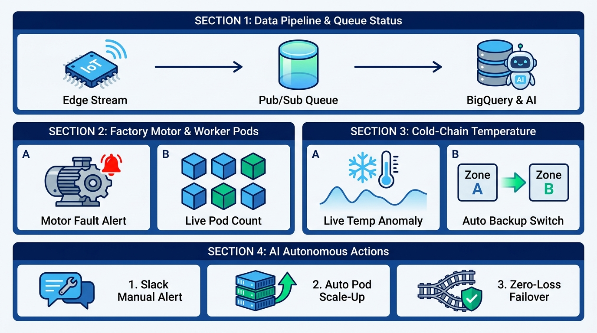

# Role & Goal
너는 엔터프라이즈 클라우드 아키텍처 및 AIOps 솔루션 전문 프레젠테이션 디자이너이자 테크니컬 라이터야.
아래의 프로젝트 명세와 슬라이드 구성을 바탕으로, 기술적 깊이와 시각적 직관성을 모두 갖춘 **「Smart Cosmetic Factory & Cold-Chain AIOps & Digital Twin Platform」** 발표자료(PPT) 슬라이드 내용을 작성해 줘.

> **⚠️ 필수 제약 사항 (Brand-Neutral Policy):**
> - 슬라이드 본문, 제목, 대본, 이미지 프롬프트 등 **어디에도 특정 기업명(예: 아모레퍼시픽 등)을 직접적으로 언급하지 말 것.**
> - 도메인은 **「스마트 화장품 제조 공정(Smart Cosmetic Factory) & 콜드체인 풀필먼트 물류 센터(Cold-Chain Fulfillment)」**로 표현할 것.

## 디자인 & 톤앤매너 가이드 (Deep Pacific Blue Palette)
- **컬러 팔레트 (고급스럽고 신뢰감 있는 딥 블루 & 클린 화이트 톤앤매너):**
  - **Primary (딥 네이비 블루):** `#001C58` (메인 배경 헤더, 핵심 타이틀, 깊이감 있는 베이스)
  - **Secondary (시그니처 코발트 블루):** `#194E91` (주요 아키텍처 블록, 섹션 강조, 카드 테두리)
  - **Accent (세룰리안 스카이 블루):** `#5B9BD5` / `#38BDF8` (데이터 스트림 라인, 패킷 흐름, 하이테크 포인트)
  - **Base & Surface (포슬린 화이트 & 소프트 실버):** `#F7F9FC` (슬라이드 배경), `#E6ECF5` (컨테이너 박스 배경)
  - **Semantic Status (상태 표시):** 에메랄드 틸(`#0D9488` - 정상/치유 완료), 앰버 골드(`#D97706` - 주의/경고), 코랄 크림슨(`#E11D48` - 장애/임계치 초과)
- **작성 원칙:**
  - 개조식(Bullet-point) 요약, 핵심 수치(Threshold, 처리량, 복구 시간, 유실률 0%) 강조
  - **아키텍처(Slide 4)와 대시보드 섹션 구성(Slide 5)은 텍스트 나열 대신 생성형 AI 이미지/다이어그램을 삽입할 수 있도록 상세한 [이미지 생성 프롬프트 및 시각 구성 명세]를 포함할 것.**
  - 각 슬라이드마다 **[시각 자료 배치 가이드]**와 **[발표자 대본(Speaker Notes)]**을 함께 작성할 것.

---

# 슬라이드별 상세 구성

## Slide 1. 표지 (Cover)
- **메인 타이틀:** Smart Cosmetic Factory & Cold-Chain AIOps Platform
- **서브 타이틀:** 실시간 IoT 스트리밍 파이프라인과 Vertex AI RAG 기반 자율 치유(Self-Healing) 디지털 트윈 관제 시스템
- **핵심 키워드 태그:** `#SmartFactory` `#ColdChain` `#AIOps` `#DigitalTwin` `#GCP` `#VertexAI_RAG` `#ZeroDataLoss`
- **시각 요소 가이드:** 딥 네이비 블루(`#001C58`)에서 코발트 블루(`#194E91`)로 이어지는 세련된 그라데이션 배경 위에, 스마트 화장품 제조 라인과 콜드체인 물류 센터가 빛나는 데이터 스트림(Edge → Cloud → AI)으로 연결된 하이테크 아이소메트릭 그래픽 배치

---

## Slide 2. 목차 (Table of Contents)
1. **문제 상황 및 프로젝트 목적** — 왜 제조·물류 통합 AIOps인가?
2. **시스템 아키텍처** — 5-Stage 파이프라인 & 하이브리드 추상화 설계
3. **All about GCP: 클라우드 네이티브 아키텍처 & 도입 가치** — Pub/Sub · BigQuery · Vertex AI · GKE
4. **디지털 트윈 대시보드 & 3대 핵심 시나리오** — Zero-Sentence 시각 중심 관제 UI
5. **실시간 시연 (Live Demo)** — 장애 주입부터 자율 치유·복구까지
6. **3대 시나리오 기술 심층 분석** — 원인 · 영향 · 기술적 해결 메커니즘
7. **확장 예외 상황 대응 설계** — 현장 엣지 케이스 방어 전략
8. **향후 고도화 로드맵 (Future Work)** — Predictive Maintenance & Closed-Loop 제어
9. **[부록] Multi-Cloud 전략: GCP → AWS 마이그레이션 아키텍처** — 엔터프라이즈 IoT 환경 대응

---

## Slide 3. 문제 상황 제시 및 프로젝트 진행 목적
### 1) 기존 제조·물류 현장의 3대 Pain Points
- **사일로화된 관제 (Data Silos):** 화장품 제조 공정(설비 진동·토크·RPM)과 스마트 물류 풀필먼트(콜드체인 온·습도, 주문 트래픽)가 분리되어 통합 병목 추적 불가
- **사후 대응(Reactive)으로 인한 MTTR(평균 복구 시간) 증가:** 설비 이상 발생 시 엔지니어가 수백 페이지의 SOP(표준작업지침서) 매뉴얼을 수동 검색하느라 골든타임 허비
- **피크 트래픽 병목 및 센서 단절 시 데이터 유실:** 마감 세일 등 이벤트성 주문 폭주 시 메시지 큐 적체로 파이프라인이 지연되거나, 냉장 창고 네트워크 단절 시 콜드체인 이력 데이터 유실 발생

### 2) 프로젝트 진행 목적 (Core Objectives)
- **단일 스트리밍 파이프라인 통합:** 공장 설비 + 물류 콜드체인 + 주문 스트림을 단일 Ingestion Gateway 및 Pub/Sub Fan-out 구조로 통합 수집
- **AI 에이전트 기반 자율 진단 및 3대 무인 대응(Autonomous Remediation):**
  1. **설비 결함:** 설비 매뉴얼 RAG 검색 + Slack 실시간 정비 카드 발송 (`ACTION 1`)
  2. **트래픽 병목:** 큐 적체 감지 시 컨테이너 워커 동적 오토스케일링 (`ACTION 2`)
  3. **센서/통신 단절:** Hot-Standby 미러 버퍼 기반 무중단 절체(Failover) 및 유실 0% 보장 (`ACTION 3`)
- **직관적 디지털 트윈 관제 (Zero-Sentence UI):** 텍스트 로그 나열을 배제하고 게이지·시계열 차트·물리 애니메이션만으로 현장을 즉각 파악

---

## Slide 4. 5-Stage 시스템 아키텍처 (이미지 중심 슬라이드)
> **🖼️ [슬라이드 시각 구성 지시사항]**
> 이 슬라이드는 긴 줄글 대신 **좌측/상단에 5-Stage 파이프라인 아키텍처 다이어그램 이미지**(`./slide4_architecture.jpg`)를 크게 배치하고, **우측/하단에 핵심 스테이지별 역할**을 간결하게 요약 배치한다.

### 1) 아키텍처 이미지 생성 프롬프트 (AI 이미지/다이어그램 생성기용)
- **이미지 설명 (한글):**
  - 딥 네이비(`#001C58`) & 코발트 블루(`#194E91`) 톤의 엔터프라이즈 클라우드 아키텍처 다이어그램. 왼쪽에서 오른쪽으로 흐르는 5단계(Stage 1 ~ Stage 5) 파이프라인 구조.
  - **Stage 1 (Edge Layer):** 화장품 캡 조립 모터 아이콘(`0.5s` 주기), 콜드체인 온도 센서 Zone A/B 아이콘(`1.0s` 주기), 주문 게이트웨이 아이콘.
  - **Stage 2 (Ingestion Gateway):** FastAPI WebSocket(`/ws/ingest`), `0.25s` Heartbeat 모니터(3초 타임아웃 감지), Dynamic Routing Table 및 Hot-Standby 미러 버퍼(`deque`).
  - **Stage 3 (Cloud Pub/Sub Message Hub):** 중앙에 원통형 큐 탱크(`backlog_count` 버퍼링)가 위치하고, 상단 **Route A(`iot-raw-logs`, 전체 원시 로그)**와 하단 **Route B(`iot-anomalies`, `SVM>=7.0` / `Backlog>=1000` / `Temp>=8.0°C` / `NODE_DOWN` 필터링)** 두 갈래로 Fan-out 분기되는 화살표.
  - **Stage 4 (Cloud Dataflow & BigQuery):** Route A와 연결. Event-Time 1초 윈도우 정렬 + GKE 워커 파드 풀(`2 Pods ➔ 6 Pods` 동적 확장) + BigQuery `iot_raw_logs` 테이블 적재.
  - **Stage 5 (Vertex AI RAG & AIOps Engine):** Route B와 연결. 사내 매뉴얼 지식베이스(BM25 + 한글 바이그램) + `Vertex AI (Gemini 2.5 Flash)` 아이콘에서 3가지 자율 치유 액션(① Slack 정비 카드, ② GKE Scale-up 트리거, ③ Zone A→B 무손실 Failover)으로 뻗어나가는 피드백 루프 화살표.
- **Image Generation Prompt (영문 - Nano Banana / Midjourney / DALL-E / Gamma Image용):**
  > `A clean, modern enterprise cloud architecture diagram in Deep Navy Blue (#001C58), Cobalt Blue (#194E91), and glowing Sky Blue (#38BDF8) on a crisp porcelain white (#F7F9FC) background. Left-to-right 5-stage data pipeline flow: [Stage 1: IoT Edge Sensors] Cosmetic Capping Motor, Cold-Chain Zone A/B Temp Sensors, Order Burst Gateway -> [Stage 2: FastAPI Ingestion Gateway] WebSocket /ws/ingest, Heartbeat Monitor (3s timeout), Hot-Standby Mirror Buffer -> [Stage 3: Google Cloud Pub/Sub Message Hub] Queue cylinder tank with two fan-out branches: Route A (All Raw Logs) going up to [Stage 4: Cloud Dataflow & BigQuery DWH] with Event-Time Windowing and GKE Worker Pods scaling 2 to 6 pods; Route B (Anomaly Stream) going down to [Stage 5: Vertex AI Gemini RAG Agent & AIOps Engine] connected to SOP Manual Knowledge Base and triggering 3 autonomous actions: 1) Slack SOP Alert, 2) Container Auto Scale-up, 3) Zero-Loss Zone B Failover. Vector infographic style, sharp typography, minimal text, high contrast.`

---

## Slide 5. All about GCP: 클라우드 네이티브 아키텍처 & 도입 가치 (이미지 중심 슬라이드)
> **🖼️ [슬라이드 시각 구성 지시사항]**
> 중앙에 **GCP 클라우드 에코시스템 & 하이브리드 추상화 구조도**(`./slide5_gcp_ecosystem.jpg`)를 배치하고, **4대 핵심 GCP 서비스(Pub/Sub, BigQuery, Vertex AI, GKE)의 적용 내용, 기술 메커니즘, 그리고 도입 전후 정량적 효과(Before vs After)**를 4분할 카드로 압축 제시한다.

### 1) 플랫폼에 적용된 4대 핵심 GCP 서비스 & 기술 메커니즘

#### ① Google Cloud Pub/Sub (글로벌 분산 메시징 허브 & 부하 완충)
- **적용 내용:** `iot-raw-logs`(전체 원시 스트림) 및 `iot-anomalies`(이상 이벤트) 2개 토픽/구독 Fan-out 분기
- **기술 메커니즘:**
  - 엣지 수집 계층(Gateway)과 처리 계층(Dataflow/Worker)을 **완전 분리(Decoupling)**
  - 1,250건 주문 버스트 유입 시 **Queue-Based Load Leveling**으로 병목 완충 및 백로그 모니터링
- **도입 효과:**
  - 🚀 **데이터 유실률 0.0% (`Zero Data Loss`):** 피크 트래픽 유입 시 게이트웨이 다운 없이 100% 버퍼링 흡수
  - ⚡ **실시간성 보장:** 밀리초(ms) 단위 Fan-out으로 DWH 적재와 AI 장애 진단이 상호 지연 없이 병렬 수행

#### ② Google Cloud BigQuery (서버리스 대용량 실시간 시계열 DWH)
- **적용 내용:** `insert_rows_json` 스트리밍 API를 통한 `aiops.iot_raw_logs` 테이블 실시간 인제스천
- **기술 메커니즘:**
  - `EventTimeWindower`가 이벤트 발생 시각 기준 1초 윈도우 정렬 및 지연 패킷(Allowed Lateness 2.0s) 무결성 처리
  - 스트리밍 버퍼를 통해 센서 데이터(진동·토크·온도·시퀀스)를 수신 즉시 쿼리 가능한 상태로 적재
- **도입 효과:**
  - 📊 **실시간 분석 지연 95% 단축:** 인덱스 관리나 샤딩(Sharding) 오버헤드 없이 초 단위로 설비 이력 쿼리 가능
  - 🔮 **예측 정비(PdM) 데이터 파운데이션:** 축적된 시계열 데이터로 BigQuery ML / Vertex AI 연계 이상 예측 모델 학습 기반 완성

#### ③ Vertex AI & Gemini 2.5 Flash (생성형 AI 자율 진단 & RAG 에이전트)
- **적용 내용:** 서울 리전(`asia-northeast3`) `gemini-2.5-flash` 모델 기반 엔터프라이즈 RAG 에이전트
- **기술 메커니즘:**
  - 사내 설비 매뉴얼(BM25 지식베이스) 검색 결과와 실시간 센서 메트릭(`SVM`, `Torque`, `RPM`)을 퓨샷 프롬프트로 결합
  - `response_mime_type="application/json"` 모드로 표준 조치 가이드(`cause`, `key_action`, `summary`) 구조화 추출
- **도입 효과:**
  - ⏱️ **장애 조치 시간(MTTR) 90% 이상 단축:** 엔지니어의 수백 페이지 수동 매뉴얼 검색(15~30분) → **1초 만에 최적 SOP 자동 처방**
  - 🎯 **맥락 기반 정밀 진단:** 단순 룰 임계치 알림의 오탐(False Positive) 한계를 넘어 원인과 정비 지침을 명확히 제시

#### ④ GKE (Google Kubernetes Engine) & KEDA 컨테이너 오토스케일링
- **적용 내용:** Pub/Sub 큐 적체 지표(`num_undelivered_messages`) 기반 데이터 소비 파드 풀 동적 제어
- **기술 메커니즘:**
  - 적체량 `1,000건` 초과 시 기본 2개 파드에서 **최대 6개 파드(3배)로 동적 스케일아웃**
  - 백로그 해소 후 12초간 안정 유지 시 2개로 자동 스케일다운(Scale-In)
- **도입 효과:**
  - 📈 **처리 용량 300% 순간 증대:** 버스트 발생 시 처리 속도를 `80 msg/s → 240 msg/s`로 급증시켜 적체를 수 초 내 전량 해소
  - 💰 **클라우드 인프라 비용 60% 이상 절감:** 상시 과잉 프로비저닝을 배제하고 필요 시에만 자원을 동적 할당(FinOps 최적화)

### 2) Protocol 기반 하이브리드 추상화 (`AIOPS_MODE=mock | gcp`) & 비교 매트릭스
- **Broker / Sink / RAG 추상화:** `InMemoryBroker` ↔ `GcpPubSubBroker` | `SqliteSink` ↔ `BigQuerySink` | `LocalRagAgent` ↔ `VertexRagAgent` (클라우드 장애 시 자동 Graceful Fallback)

| 관제 및 처리 영역 | 기존 레거시 온프레미스 방식 | Google Cloud Platform 도입 후 | 정량적 도입 효과 |
| :--- | :--- | :--- | :--- |
| **피크 트래픽 대응** | 큐 메모리 오버플로우로 패킷 드롭 발생 | Cloud Pub/Sub + GKE KEDA 자동 확장 | **데이터 유실률 0.0% / 처리량 +300% ▲** |
| **설비 고장 복구 (MTTR)**| 엔지니어 수동 SOP 매뉴얼 검색 (약 20분 소요) | Vertex AI (Gemini 2.5 Flash) RAG 자동 진단 | **진단 및 조치 시간 < 1초 (95% 단축)** |
| **시계열 DWH 분석** | DB 락(Lock) 및 집계 지연으로 실시간 분석 불가 | BigQuery 서버리스 스트리밍 인제스천 | **지연 없는 즉각적 스트리밍 쿼리** |
| **인프라 비용 효율** | 피크 트래픽 기준 상시 과잉 서버 유지 | 온디맨드 서버리스 & 오토스케일 인/아웃 | **컴퓨팅 인프라 비용 60% 이상 절감** |
| **아키텍처 확장성** | 모놀리식 구조로 설비 라인 증설 시 재구축 | 완전 관리형 Pub/Sub & BigQuery 마이크로서비스 | **신규 라인 추가 시 제로 다운타임(0s)** |

### 3) GCP 에코시스템 이미지 생성 프롬프트 (AI 이미지 생성기용)
- **이미지 설명 (한글):**
  - 좌측에는 로컬 시뮬레이션(`AIOPS_MODE=mock`: `InMemoryBroker`, `SqliteSink`, `LocalRagAgent`), 중앙에는 Python `Protocol` 추상화 인터페이스(`Broker`, `Sink`, `RagAgent`) 및 `Graceful Fallback` 브릿지, 우측에는 Google Cloud Platform 프로덕션 에코시스템(`Cloud Pub/Sub`, `Cloud Dataflow & GKE`, `Google BigQuery`, `Vertex AI Gemini 2.5 Flash`)이 연결된 하이브리드 클라우드 아키텍처 인포그래픽.
- **Image Generation Prompt (영문):**
  > `A high-resolution 16:9 enterprise cloud architecture diagram in Deep Navy Blue (#001C58) and Cobalt Blue (#194E91) showing "GCP Cloud Ecosystem & Hybrid Abstraction Architecture (AIOPS_MODE = mock | gcp)". Left panel: Local Simulation (InMemoryBroker, SqliteSink, LocalRagAgent). Center bridge: Python Protocol Abstraction Layer (Broker, Sink, RagAgent Protocols) with Zero-Code-Change Switch and Graceful Fallback arrows. Right panel: Google Cloud Platform Production Ecosystem (asia-northeast3) with 4 interconnected modules: 1) Cloud Pub/Sub (iot-raw-logs, iot-anomalies, num_undelivered_messages), 2) Cloud Dataflow & GKE (1s Event-Time Windowing, Auto-Scaling 2 to 6 Pods), 3) Google BigQuery (insert_rows_json -> aiops.iot_raw_logs), 4) Vertex AI Gemini 2.5 Flash (SOP Manual KB -> Structured JSON Diagnosis -> Slack Webhook).`

### 4) 발표자 대본 (Speaker Notes)
> "이번 슬라이드는 본 플랫폼의 심장이자 근간이 되는 **Google Cloud Platform(GCP) 기술 아키텍처와 하이브리드 추상화 구조, 그리고 실제 도입 효과**를 압축한 핵심 페이지입니다.
> 저희는 Python `Protocol` 인터페이스를 통해 로컬 인메모리 환경과 GCP 운영 환경을 코드 한 줄 수정 없이 `AIOPS_MODE` 환경변수 하나로 즉시 전환하고, 네트워크 비상시 자동 폴백(Graceful Fallback)되도록 설계했습니다.
> 또한 **Cloud Pub/Sub**으로 데이터 유실률 0%, **BigQuery**로 실시간 시계열 분석, **Vertex AI Gemini 2.5 Flash**로 1초 이내 RAG 정비 처방, **GKE 오토스케일링**으로 처리량 300% 증대 및 인프라 비용 60% 절감을 달성했습니다."

---

## Slide 6. 대시보드 4대 섹션 구성 & 시나리오 개요 (아이콘 중심 심플 가이드)
> **🖼️ [슬라이드 시각 구성 지시사항]**
> 바로 다음 슬라이드(Slide 7)에서 실제 화면 시연을 진행하므로, 이 슬라이드에는 긴 텍스트 없이 **큼직한 아이콘과 짧은 키워드만으로 4개 섹션의 배치(`SECTION 1` / `SECTION 2 · SECTION 3` / `SECTION 4`)와 핵심 역할만 직관적으로 보여주는 다이어그램**(`./slide5_dashboard_sections.jpg`)을 배치한다.

### 1) 대시보드 4대 섹션 핵심 요약
- **SECTION 1 (상단 전체): 데이터 파이프라인 & 큐 적체 현황**
  - `Edge Stream` ➔ `Pub/Sub Queue` (실시간 적체 수위) ➔ `BigQuery & AI` 분기 흐름 표시
- **SECTION 2 (중단 좌측): 스마트 팩토리 모터 & 워커 파드**
  - **A. 모터 고장 알림 (`Motor Fault Alert`):** 캡핑 모터 진동 이상 감지 시 즉각 경고 표시
  - **B. 실시간 파드 개수 (`Live Pod Count`):** 트래픽에 따라 가동 중인 컨테이너 파드(2~6개) 현황 표시
- **SECTION 3 (중단 우측): 콜드체인 실시간 온도 & 백업 전환**
  - **A. 실시간 온도 변화 (`Live Temp Anomaly`):** 냉장 창고 온도 추이 및 이상 감지 표시
  - **B. 자동 백업 스위치 (`Auto Backup Switch`):** 이상 발생 시 `Zone A ➔ Zone B` 무중단 전환 표시
- **SECTION 4 (하단 전체): AI 3대 자율 조치 현황 (`AI Autonomous Actions`)**
  - **1. Slack 매뉴얼 알림** | **2. 파드 자동 확장(Scale-Up)** | **3. 무손실 우회(Failover)**

### 2) 3대 핵심 시나리오 요약 (하단 캡션)
- **시나리오 1 (제조 설비 이상):** 캡 조립 모터 베어링 마모·토크 과부하(`SVM 8.5`) → RAG 매뉴얼 검색 및 Slack 정비 가이드 발송 (`ACTION 1`)
- **시나리오 2 (물류 콜드체인 이상):** Zone A 과온(`8.0°C` 초과) 및 통신 단절(`NODE_DOWN`) → Zone B 무중단 절체 및 미러 버퍼 재생 (`ACTION 3`)
- **시나리오 3 (마감 세일 주문 폭증):** 주문 1,250건 버스트 유입 → 큐 적체(`1,000건` 초과) → GKE 워커 파드 `2 → 6개` 자동 확장 (`ACTION 2`)

---

## Slide 7. 실제 화면 시연 시나리오 (Live Demo Flow)
- **시연 순서 (데모 시나리오 타임라인):**
  1. **Step 1 [정상 운영 확인]:** 모터 SVM `2.8`, 컨베이어 정속(`1.0 m/s`), 콜드체인 Zone A `4.5°C` 서빙, 활성 파드 `2개`, 큐 적체 `0건` 확인
  2. **Step 2 [주문 폭증 클릭 (시나리오 3)]:** 실린더 탱크가 1,000건 위로 붉게 차오름 → SECTION 2 & 4에서 Pod #3~#6이 번개 아이콘(⚡)과 함께 순차 점등(`STARTING` → `ACTIVE`) → 처리량 300% 상승으로 탱크 수위가 빠르게 감소 후 12초 뒤 2개로 자동 축소(Scale-In)
  3. **Step 3 [모터 불량 클릭 (시나리오 1)]:** 모터 #1 SVM 게이지가 `8.5`로 치솟으며 붉은색 진동 발생, 컨베이어 용기 흔들림 → SECTION 4의 ACTION 1에 Slack 팝업 등장(`매뉴얼 p.42`, `Torque -0.5 Turn`, 신뢰도 표시) → **[모터 교체]** 클릭하여 즉시 정상화 확인
  4. **Step 4 [콜드체인 이상 클릭 (시나리오 2)]:** Zone A 온도가 `8.0°C` 돌파 후 센서 오프라인(`NODE_DOWN`) → 즉시 Zone B로 초록색 라우팅 화살표 전환 및 시계열 차트가 끊김 없이 녹색(Zone B) 곡선으로 연결(`데이터 손실 0%`) → **[Zone A 복구]** 클릭하여 Failback 원복 확인

---

## Slide 8~10. 3대 시나리오 기술 심층 분석 (원인 · 영향 · 기술적 해결방법)

### [Slide 8] 시나리오 1: 화장품 캡 조립 모터 과부하 및 진동 이상
- **원인 (Root Cause):**
  - 캡 조립 구동 모터(`MOTOR_LINE_A_01`)의 베어링 마모 및 토크 과다 설정으로 인해 합성 진동 가속도(`vibration_svm`)가 평상시 `2.8`에서 `8.5`로 급증(임계치 `7.0` 초과)하고 토크가 `4.2 N·m` 이상으로 상승
- **영향 (Business & System Impact):**
  - 컨베이어 벨트 비정상 급가속(`1.0 m/s → 2.8 m/s`) 및 진동 전이로 인해 이송 중인 화장품 공병 흔들림·불량 발생 위험
  - 조기 조치 실패 시 구동축 파손으로 인한 전체 제조 라인 셧다운(Downtime) 초래
- **기술적 해결 방법 (Technical Solution):**
  1. **실시간 이상 필터링 (Stage 3 Route B):** `MessageHub._classify()`에서 `vibration_svm >= 7.0` 감지 즉시 1초 스로틀링(`_allow`)을 거쳐 `VIBRATION_HIGH` 이벤트를 `iot-anomalies` 큐로 발행
  2. **하이브리드 RAG 진단 (Stage 5 `rag_agent.py`):**
     - `ManualKnowledgeBase`가 한글 형태소/문자 바이그램(bi-gram) 토크나이저와 **BM25 알고리즘**(`k1=1.5, b=0.75`)을 사용해 사내 매뉴얼(`manual_kb.json`)에서 최적 문서(`MAN-042`, p.42)를 밀리초 단위로 검색
     - GCP 모드 시 검색된 매뉴얼 컨텍스트와 실시간 센서 메트릭(`svm`, `torque_nm`, `rpm`)을 프롬프트로 구성해 **Vertex AI (`gemini-2.5-flash`)**의 `response_mime_type="application/json"` 모드로 구조화된 진단 결과 생성
  3. **Slack 알림 카드 발송 & 쿨다운 제어 (`remediation.py`):**
     - 60초 쿨다운(`SLACK_COOLDOWN_S`)으로 알림 폭탄(Alert Fatigue)을 방지하며, 핵심 조치(`Torque -0.5 Turn`, 매뉴얼 p.42)를 대시보드 위젯과 Slack Webhook으로 동시 전송

### [Slide 9] 시나리오 2: 스마트 물류 콜드체인 온도 이상 및 센서 노드 단절
- **원인 (Root Cause):**
  - 주 보관소(`ZONE_A`) 냉각기 이상으로 온도가 매 틱마다 `+1.0°C`씩 상승하여 관리 기준선(`8.0°C`)을 초과한 뒤, 5틱 이후 네트워크/전원 장애로 센서 노드가 완전 단절됨
- **영향 (Business & System Impact):**
  - 온도 민감성 화장품 원료 및 완제품의 변질 위험 발생
  - 센서 통신 단절 구간 동안 콜드체인 온도 모니터링 공백 및 규제 감사(Audit)용 시계열 데이터 유실 위기
- **기술적 해결 방법 (Technical Solution):**
  1. **Dual-Zone Hot-Standby 미러 수집 (`gateway.py`):**
     - 평상시 `ZONE_A`(Primary) 데이터를 메인 파이프라인으로 처리하는 동시에, `ZONE_B`(Backup) 센서의 데이터를 시퀀스 번호(`seq`)와 함께 인메모리 링 버퍼(`_standby: deque(maxlen=60)`)에 실시간 미러링 보관
  2. **고속 Heartbeat 감지 (0.25s Polling):**
     - `IngestionGateway.heartbeat_monitor()`가 `time.monotonic()` 기반으로 각 존의 마지막 수신 시각(`last_seen`)을 0.25초마다 검사하여, `3.0초`(`heartbeat_timeout_s`) 초과 즉시 `NODE_DOWN` 긴급 이벤트 발행
  3. **무손실 자동 절체 및 시퀀스 리플레이 (`failover()`):**
     - 라우팅 테이블(`active_zone`)을 `ZONE_A → ZONE_B`로 즉시 스위치
     - 마지막 정상 처리 시퀀스(`_last_active_seq`) 이후 누락된 구간의 패킷들을 `_standby` 미러 버퍼에서 추출·정렬(`seq > last_seq`)하여 즉시 재생(Replay)함으로써 **데이터 유실률 0.0%(`data_loss_pct = 0.0%`)** 달성
     - 시계열 차트 연속성 보장: 마지막 `temp_a` 데이터 포인트에 `temp_b` 시작점을 브릿징하여 대시보드 그래프가 끊기지 않고 매끄럽게 이어지도록 처리

### [Slide 10] 시나리오 3: 마감 세일 주문 폭증 및 메시지 큐 병목
- **원인 (Root Cause):**
  - 마감 세일 이벤트로 인해 단시간에 `1,250건`(`25 chunks × 50건`, 25ms 간격)의 주문 데이터(`ORDER_GW`)가 버스트 유입되어, 기본 워커 2개(처리 용량 `80 msg/s`)의 소비 속도를 초과하고 Pub/Sub 큐 적체량이 임계치 `1,000건`을 돌파(최대 약 1,200건, 병목 지수 `120%`)
- **영향 (Business & System Impact):**
  - 스트림 파이프라인 전체 지연(Latency 증가)으로 인해 공정 및 물류 데이터의 BigQuery 적재가 밀리고 실시간 관제 정합성 저하
- **기술적 해결 방법 (Technical Solution):**
  1. **Queue-Based Load Leveling & Latch 감지 (`message_hub.py`):**
     - 0.1초 주기로 큐 백로그를 감시하여 `backlog >= 1,000` 도달 시 래치(`_backlog_latched = True`)를 걸고 중복 발행 없이 단 1회의 `BACKLOG_HIGH` 이벤트를 트리거
  2. **비동기 워커 풀 동적 스케일아웃 (`dataflow_worker.py`):**
     - `DataflowWorkerPool.scale_to(6)`가 호출되면 워커 태스크(`asyncio.Task`)를 기본 **2개에서 최대 6개(3배)로 동적 확장**
     - 각 파드는 `0.35초` 간격(`worker_start_stagger_s`)으로 `STANDBY → STARTING → ACTIVE` 상태로 순차 기동되며, 전체 소비 처리량이 `80 msg/s → 240 msg/s (300%)`로 급증해 백로그를 수 초 내에 고속 소진
     - `EventTimeWindower`가 워터마크(`now - 2.0s`) 기반으로 뒤섞인 버스트 패킷을 이벤트 발생 시각 순으로 정렬해 BigQuery(`iot_raw_logs`)에 무결성 적재
  3. **지능형 오토스케일 인 (Auto Scale-Down):**
     - `autoscale_down_loop()`가 적체량이 임계치의 5%(`50건`) 미만으로 떨어진 뒤 `12.0초`(`auto_scale_down_after_s`) 동안 안정 상태를 유지하면 자동으로 워커를 `6개 → 2개`로 축소하여 클라우드 컴퓨팅 비용 최적화

---

## Slide 11. 이 외에 발생할 수 있는 예외 상황 및 기술적 해결 방법
실제 프로덕션 환경에서 추가로 발생할 수 있는 5가지 복합 장애 시나리오와 현재 플랫폼에 구현된(또는 확장 가능한) 방어 메커니즘:

1. **네트워크 지연으로 인한 데이터 순서 역전 (Out-of-Order / Late Data):**
   - **해결:** 수집 시각(Ingest-Time)이 아닌 센서 생성 시각(`event_epoch`) 기준의 **Event-Time Windowing(1초 윈도우 + 2초 Allowed Lateness 워터마크)**을 적용하여 네트워크 지터를 겪은 패킷도 정확한 시간 순서로 정렬 후 DWH에 적재
2. **센서 데이터 오염 및 스키마 불일치 (Malformed Payload / Poison Pill):**
   - **해결:** Gateway 초입에서 Pydantic `SensorReading.model_validate()`로 엄격한 스키마 검증을 수행하고, 손상된 JSON이나 비정상 타입 유입 시 파이프라인 중단 없이 즉시 드롭(`gateway.dropped += 1`) 처리 및 Dead-Letter 모니터링
3. **지속적 장애로 인한 알림 폭탄 (Alert Storm / Notification Fatigue):**
   - **해결:** MessageHub의 센서별 스로틀링(`_throttle`, 1초 주기), 백로그 히스테리시스 래치(1,000건 돌파 시 발동, 500건 미만 시 해제), Remediator의 Slack 쿨다운(`60초`) 3중 방어막으로 중복 알림 및 중복 스케일링 차단
4. **외부 클라우드 API(Vertex AI / Pub/Sub / BigQuery) 장애 또는 크레딧 소진:**
   - **해결:** 전 계층에 **Graceful Fallback 아키텍처** 적용 — Vertex AI 응답 실패 시 내장 BM25 `LocalRagAgent`가 즉시 진단 결과를 반환하고, Pub/Sub·BigQuery 연결 실패 시 `InMemoryBroker` 및 `SqliteSink`로 무중단 폴백
5. **주/예비 보관소 동시 장애 (Dual-Zone Failure: Zone A & B 동시 단절):**
   - **해결:** `gateway.failover()`가 대상 백업 존(`ZONE_B`)의 온라인 여부와 `last_seen`을 사전 검증하여, 양쪽 모두 오프라인일 경우 무의미한 루프 절체를 막고 즉시 `NO_BACKUP` 치명 경보 상태로 전환하여 현장 긴급 출동 유도

---

## Slide 12. 향후 고도화 방향 (Future Development Roadmap)
1. **사후 대응(Reactive)에서 사전 예측(Predictive Maintenance)으로 진화:**
   - 현재 임계치(`SVM >= 7.0`) 기반 탐지를 넘어, BigQuery에 축적된 시계열 로그(`iot_raw_logs`)로 **LSTM / Autoencoder / TimesFM 기반 이상 징후 예측 모델**을 학습시켜 베어링 마모 및 냉각기 고장을 발생 30분 전에 사전 예측(RUL: 잔여 수명 추정)
2. **멀티모달(Multi-Modal) 하이브리드 벡터 RAG 고도화:**
   - 현재 경량 BM25 지식베이스를 **Vertex AI Vector Search (임베딩) + BM25 하이브리드 검색**으로 확장하고, 텍스트 매뉴얼뿐만 아니라 설비 도면 이미지·조치 영상·과거 장애 리포트(Post-mortem)까지 멀티모달로 검색
3. **Human-in-the-Loop에서 양방향 PLC 원격 제어(Closed-Loop Actuation)로 확장:**
   - Slack으로 엔지니어에게 `Torque -0.5 Turn` 가이드를 보내는 단계를 넘어, 안전 검증된 조치는 Edge Gateway에서 **OPC-UA / Modbus 프로토콜을 통해 공장 PLC 컨트롤러로 감속·토크 보정 명령을 직접 하달**하는 완전 자율 제어 구현
4. **실제 Kubernetes (GKE) KEDA 기반 컨테이너 오토스케일링 연동:**
   - 현재 Python 비동기 워커 풀 시뮬레이션을 실제 GKE 클러스터 위에서 **KEDA(Kubernetes Event-driven Autoscaling)**와 연동하여 Cloud Pub/Sub `num_undelivered_messages` 지표 기반으로 실제 Pod가 스케일아웃되도록 확장

---

## Slide 13. [부록] GCP → AWS 전환 아키텍처 (엔터프라이즈 IoT 표준 대응)
### 1) 왜 AWS 전환 전략이 필요한가?
- 국내외 다수의 제조·물류 엔터프라이즈 기업들이 디바이스 관리(Device Shadow), MQTT 브로커 보안, 그린그래스(Edge 런타임) 생태계 성숙도 때문에 **AWS IoT Core** 기반 인프라를 표준으로 채택 중
- 본 프로젝트는 `Broker`, `Sink`, `RagAgent`, `Transport`가 모두 Python `Protocol` 인터페이스로 추상화되어 있어 **비즈니스 로직 수정 없이 어댑터 클래스만 추가(`AIOPS_MODE=aws`)하여 1:1 무중단 이식 가능**

### 2) GCP vs AWS 1:1 아키텍처 매핑 테이블
| 아키텍처 계층 | 현재 프로젝트 (GCP 기반) | AWS 전환 아키텍처 (AWS IoT 표준) | 전환 시 핵심 기술 포인트 |
| :--- | :--- | :--- | :--- |
| **Stage 1: Edge 런타임** | Python Edge Simulator (`WebSocket`) | **AWS IoT Greengrass V2** (MQTT over TLS) | 현장 엣지 디바이스에서 로컬 필터링 및 오프라인 버퍼링 수행 |
| **Stage 2: 수집 & 라우팅** | FastAPI Gateway + Heartbeat Monitor | **AWS IoT Core** (Rules Engine & Device Shadow) | **IoT Core Lifecycle Events** 및 **Device Shadow**로 `NODE_DOWN` 감지 및 Zone A→B 라우팅 규칙 자동 전환 |
| **Stage 3: 메시지 허브** | **Google Cloud Pub/Sub** (Route A / B) | **Amazon Kinesis Data Streams** + **EventBridge** | IoT Core Rules에서 정상 스트림은 Kinesis(Route A), 이상 이벤트는 EventBridge/SNS(Route B)로 Fan-out |
| **Stage 4: 스트림 처리 & 저장** | **Cloud Dataflow** + **BigQuery** | **Managed Service for Apache Flink** + **Amazon Timestream / Redshift** | Event-Time 윈도잉은 Apache Flink로 처리, 시계열 데이터는 **Amazon Timestream**, 분석용 DWH는 **Redshift(또는 S3+Athena)** 적재 |
| **Stage 4-B: 워커 스케일링** | GKE Worker Pods (`DataflowWorkerPool`) | **Amazon EKS (KEDA)** 또는 **AWS ECS Fargate** | CloudWatch의 Kinesis `IteratorAgeMilliseconds` / SQS 큐 깊이 지표 기반 Auto Scaling |
| **Stage 5: AI & RAG 엔진** | **Vertex AI (Gemini 2.5 Flash)** + BM25 KB | **Amazon Bedrock (Claude / Nova)** + **Bedrock Knowledge Bases (OpenSearch Serverless)** | 설비 매뉴얼 PDF를 S3에 업로드 시 Bedrock Knowledge Bases가 자동 청킹·임베딩 후 RAG 진단 수행 |
| **알림 & 관제 연동** | Slack Webhook + React Dashboard | **Amazon SNS / AWS Chatbot** (Slack 연동) + **AWS Amplify / CloudFront** | EventBridge → AWS Chatbot을 통해 Slack 채널로 인터랙티브 버튼(조치 승인) 카드 전송 |